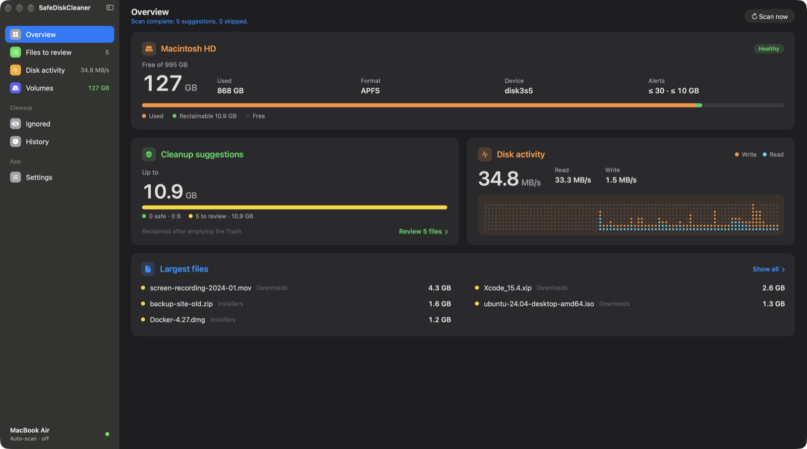
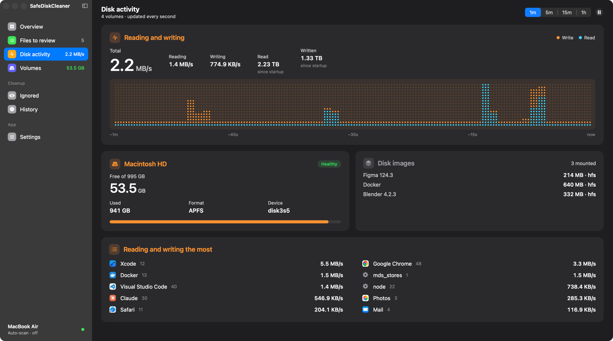

# SafeDiskCleaner

Native macOS disk-cleanup assistant written in Rust + AppKit (through `objc2`).
It finds large, old files, can optionally ask the Claude CLI for a conservative second
opinion (opt-in, metadata only, never file contents) and lets you move them to the Trash.
Nothing is ever deleted automatically.

- **Auto scan** on an interval you pick in Settings (5 min to 2 h, default 10 min). Files that
  haven't changed keep their earlier Claude verdict, so only new or changed files are sent.
- **Lists**: bookmark files into your own lists ("App Large Files" and "Document Large Files" to
  start with). Files show a type badge (App, Document, Video…) you can filter by. Entries whose
  file no longer exists are removed when you open a list.
- **Daily changes**: one snapshot per day (from the day's last scan) of used/free space per volume,
  size of each top-level folder under the scan folders, and the large files found. Compare any day
  with the day before it.

Data lives in `~/Library/Application Support/Safety Disk Cleaner/cleaner.db`
(the same database the earlier Go version used, so settings carry over).





More screens: [files to review](docs/screenshots/files.png) · [volumes](docs/screenshots/volumes.png) ·
[history](docs/screenshots/history.png) · [settings](docs/screenshots/settings.png).
Screenshots use the fake-file sandbox described below.

## Install

Download the DMG or zip from the [latest release](https://github.com/quan-vu/SafeDiskCleaner/releases/latest)
(Apple silicon, macOS 13+). The build is ad-hoc signed, not notarized: on first launch,
right-click the app and choose **Open**, or run
`xattr -dr com.apple.quarantine "/Applications/Safety Disk Cleaner.app"`.

## Privacy

- Everything runs locally. The app has no telemetry, no account and no network code of its own.
- Settings, ignored files and cleanup history live in a local SQLite file:
  `~/Library/Application Support/Safety Disk Cleaner/cleaner.db`.
- The optional AI review (**Settings → Review with Claude CLI**) runs the `claude` CLI installed on your Mac.
  It is **off by default**; nothing leaves your machine unless you turn it on. When it runs, only the file path,
  size and dates of each candidate are sent, never file contents, and at most 100 candidates per scan.
  It is skipped when the CLI is not found.
- AI verdicts are advisory: protected folders (Library, iCloud, `.git`, `.ssh`, ...) and files with an unknown or
  recent last use can never be promoted to "safe", and every file is re-checked right before cleanup.
- Folder access: only **Documents** and **Downloads** are read by default (Settings → Scan folders → "Private
  folders the app may read"; Desktop is opt-in). A folder that is not ticked is never opened, so macOS never asks
  about it, even when scanning all of Home. iCloud Drive and other cloud-synced folders are skipped and protected
  from cleanup; "Include iCloud Drive in Storage" only adds them to the Storage chart.
- Files are moved to the Trash, never deleted automatically. "Delete permanently" always asks first.
- Debug tracing (`SDC_DEBUG=1`) prints actions to stderr only when you set it yourself.

## Layout

| Path | What |
|---|---|
| `crates/sdc-core` | Pure logic, unit-tested: safety rules (`model.rs`), scan (`scan.rs`), re-validation before cleanup (`action.rs`), Claude CLI review (`review.rs`), SQLite store (`store.rs`), live disk stats via IOKit/libproc (`sysstats.rs`) |
| `crates/sdc-app` | AppKit app: window + sidebar + pages (`pages.rs`), state/actions (`app.rs`), custom views (`ui.rs`), Trash/notifications/login item/tray (`system.rs`) |
| `bundle/Info.plist` | App bundle metadata (`LSUIElement`, bundle id kept from the Go version) |
| `scripts/bundle.sh` | Builds `dist/Safety Disk Cleaner.app` (ad-hoc signed), `--dmg` for a DMG |

## Commands

```bash
make test     # cargo test --workspace
make lint     # clippy, warnings as errors
make bundle   # dist/Safety Disk Cleaner.app
make dmg      # + dist/safety-disk-cleaner-<version>-arm64.dmg
make install  # build and install the only copy in /Applications (removes old copies and dist/)
make run      # install and open
```

## Notes

- Only one instance runs at a time; a second launch shows the running window.
- The app shows in the Dock and the menu bar; closing the window only hides it.
- The UI language follows the system's preferred language (Vietnamese or English).
- Trash uses `NSFileManager.trashItemAtURL`.
- Ad-hoc signed only; notarization (Developer ID) is not set up yet.
- CI (`.github/workflows/build.yml`) runs only when a `v*` tag is pushed: tests, clippy, then the `.app` zip and DMG are uploaded as artifacts and attached to a GitHub Release.

## Testing with fake files (never touches real data)

```bash
scripts/make-test-files.sh   # dev-sandbox/home: 18 GB of *sparse* old files (~0 real disk)
scripts/run-sandbox.sh       # quits the real app, runs it with HOME=dev-sandbox/home
```

The sandbox has its own settings database, so the real one is not read or written.
It contains 5 files that should be suggested and 7 decoys that must not be (recent,
small, hidden folder, git checkout, `.photoslibrary`, `~/Library`, symlink).
Set `SDC_DEBUG=1` (done by `run-sandbox.sh`) to trace actions to `dev-sandbox/app.log`.
Items moved to the Trash from the sandbox land in your real Trash (they take no space).
